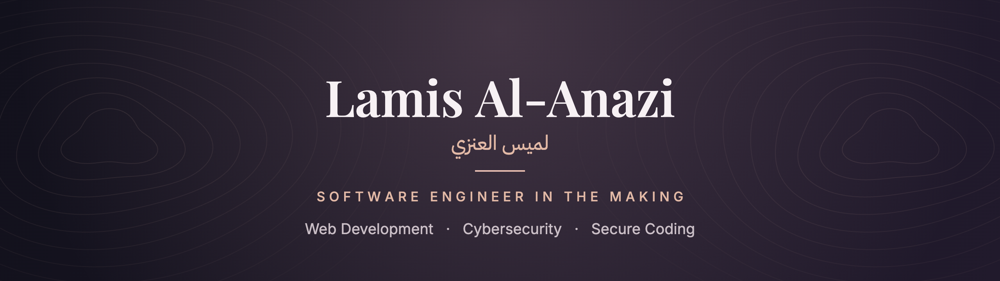

  

### Hi, I'm Lamis 👋

I'm a Software Technology student at the Digital Technical College for Girls in Riyadh, focused on **web development** and **cybersecurity**.
I learn best by building: taking an idea from a blank page to something real that people can use.

### 🛠️ What I work with

- **Web:** HTML · CSS · JavaScript
- **Security:** secure coding · OWASP Top 10
- **Tools:** Git · GitHub
- **Languages:** Arabic (native) · English

### 🛡️ Featured project

**[CodeShield](https://codeshield-sa.netlify.app)**: an Arabic-first tool that scans code for security vulnerabilities right in the browser, explains each issue in plain Arabic, and shows how to fix it. The code never leaves the user's device.

Submitted to STIEX 2026 · [Live site](https://codeshield-sa.netlify.app) · [Source code](https://github.com/codeshield-app/codeshield-app.github.io)

### 🔐 Vulnerability of the Week

A weekly LinkedIn series where I explain one common web vulnerability simply: the vulnerable code, the safer version, and why it matters.

### 🌱 Right now

- Studying Software Technology (2026 – 2028)
- Building and improving CodeShield
- Looking for internship and training opportunities

### 📫 Reach me

[LinkedIn](https://www.linkedin.com/in/lamis-alanazi) · lamisalanazi21@gmail.com

---

🇸🇦 مطوّرة ويب مهتمة بالأمن السيبراني، أبني منتجات تقنية آمنة وواضحة بالعربي

